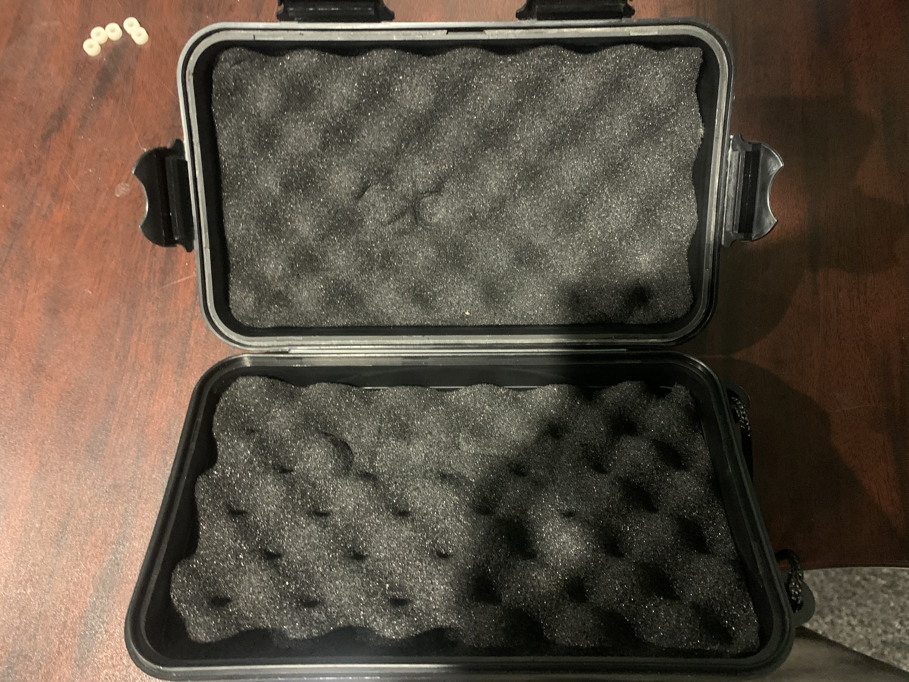
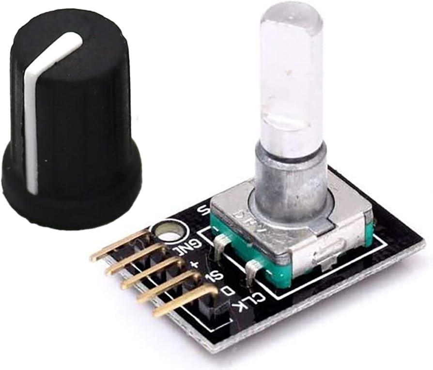
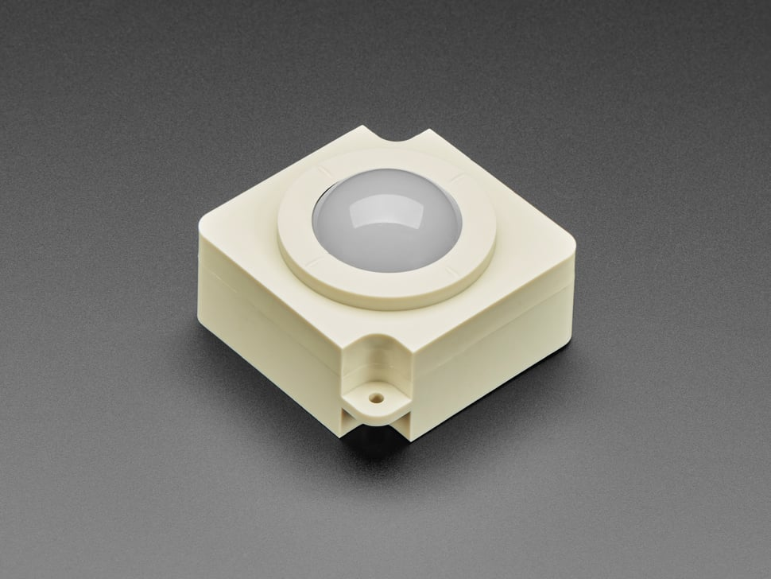

## November 24, 2026: First Day Working On My Cyberdeck!

Today I focused on finding the measurements of the case I want to put my cyberdeck into and figuring out what type of hardware I want to put in it. I started out with the measurements and found that the (interior) dimensions are 7 3/8" long, 4 7/32" wide, and a depth of 1 5/16". It is a clamshell case  so those measurements are for each half and the total depth of the whole case is 2 5/8". For the SBC I decided to go with the Orange Pi Zero 2 W with 1.5gb of ram which will allow for a lightweight OS like Armbian which is made for SBCs, for the keyboard I want something perfectly rectangular in order to not leave any weird gaps on the edges and corners of the case and that will take up most of the space for the bottom portion, for the display I want to use a 7" display and if it has a 16:9 aspect ratio then it will fit comfortably in the top half of the case taking most of the horizontal space and leaving about 1/2" on the top and bottom of empty space, for what controls the cursor I want to use a trackball because it is a more unique option than just a trackpad and since it is just a sphere it does not have the ability to scroll so I will use a rotary encoder as the scroll wheel and some extra mechanical keyboard switches will be used for left click and right click. Tomorrow I will focus on finding the exact models of the hardware I will need and make sure everything is compatible with my SBC

Cyberdeck Case

Cyberdeck Case

Rotary Encoder (Scroll Wheel)

Trackball

**Total Time Spent: 1.5h**
