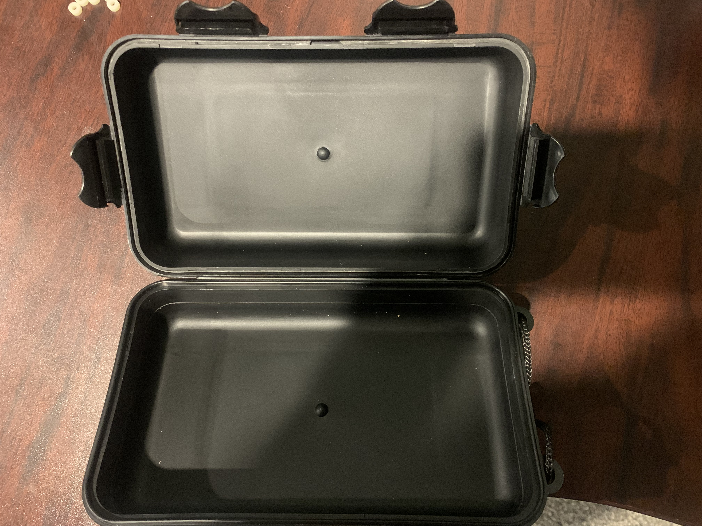

## November 24, 2026: First Day Working On My Cyberdeck!

Today I focused on finding the measurements of the case I want to put my cyberdeck into and figuring out what type of hardware I want to put in it. I started out with the measurements and found that the (interior) dimensions are 7 3/8" long, 4 7/32" wide, and a depth of 1 5/16". It is a clamshell case so those measurements are for each half and the total depth of the whole case is 2 5/8". 

For the SBC I decided to go with the Orange Pi Zero 2 W with 1.5gb of ram which will allow for a lightweight OS like Armbian which is made for SBCs. For the keyboard I want something perfectly rectangular in order to not leave any weird gaps on the edges and corners of the case and that will take up most of the space for the bottom portion. 

For the display I originally was thinking of using a 7" display, but after a quick Google search I found out that displays are measured corner to corner rather than by width and I also didn’t account for bezels which will take up some space, so instead I am going to use either a 5” or a 5.5” display which will still fit nicely into my case. 

For what controls the cursor I want to use a trackball because it is a more unique option than just a trackpad and since it is just a sphere it does not have the ability to scroll so I will use a rotary encoder as the scroll wheel and some extra mechanical keyboard switches will be used for left click and right click. Tomorrow I will focus on finding the exact models of the hardware I will need and make sure everything is compatible with my SBC.

 *My Cyberdeck Case*

 *My Cyberdeck Case*

![Rotary Encoder]images/(5171ewsBtKL._AC_UF894,1000_QL80_.jpg) *Rotary Encoder (Scroll Wheel)*

 *Trackball*

**Total Time Spent: 1.5h**

## November 25, 2026: Notes For Journal Entry: "Specifics and Compatibility":

### Parts so far:
Clamshell Case (7 3/8" long, 4 7/32" wide, and 1 5/16" deep) (each half) 
5"-5.5" display 
Rectangular Keyboard 
Trackball

### Where Things Will Fit:

The keyboard will go in the bottom half on the left side.  
The trackball will go on the right side ~1" from the middle of the width to make space for the mechanical key switches.  
The mechanical key switches will go right above the trackball side by side like a mouse's buttons.  
Because the rotary encoder acts as the scroll wheel it will go either between the key switches or right above them.  
The display will go in the top half of the case just like a laptop and I will check the bezel sizes to make sure a 5"-5.5" display can fit  
Oh and I cant forget one of the most important parts, the power source! For the power source I will use a usb power bank because that provides 5v and I chose a 10,000 MaH one because that should keep it powered for about 7 hours (powering the Orange Pi and the display) [Power bank](https://a.co/d/0j1Qg3x0) 
I will check for the depth of some displays to see if the Orange Pi Zero 2 W can fit into the top half with the display and if it cannot then it will have to go in the bottom half 
It looks like it would be a tight fit to get the SBC into the top half, so I will leave it in the bottom and I have my keyboard and mouse at the bottom which means less wires will have to go through the hinge 

### Finding a Display:

Lets start with the display:  
I will look up some 5" displays and see if they are compatible with an Orange Pi Zero 2 W.  
I found this display on Amazon: [5", 1024 x 600 ips display](https://www.amazon.ca/iPistBit-Capacitive-Touchscreen-Raspberry-Driver-Free/dp/B0FCR5WPV5/ref=asc_df_B0CP3DH3LN?mcid=95bbd2beb6903e91a7f3f4c4bd43c97b&tag=googleshopc0c-20&linkCode=df0&hvadid=706724917431&hvpos=&hvnetw=g&hvrand=17153053587808454353&hvpone=&hvptwo=&hvqmt=&hvdev=c&hvdvcmdl=&hvlocint=&hvlocphy=9195703&hvtargid=pla-2280483271340&hvcampaign=21500527601&hvocijid=17153053587808454353-B0CP3DH3LN-&hvexpln=0&gad_source=1&th=1)  
It is meant for a Raspberry Pi, so I think it will be compatible.  
It does appear to be compatible, but when I looked at the product dimensions even though the actual screen would fit there is quite a large bezel causing it to go about an inch above my max width.

##### My case is quite thick so should I look for a different aspect ratio?

Lets start off by looking at what different aspect ratios exist and are common for displays.  
21:9 and 4:1 appeared when I searched wide aspect ratios, but are they common enough to have an Orange Pi compatible display?   
Wait my Iphone XR fits perfectly in the case with enough clearance lets see what aspect ratio it uses  
While I am at it lets see what the ratio of the width and height of my case is  
How do I find the ratio?  
Ok so I need to divide both the width and height by their greatest common diviser lets first simplify my measurements  
7 3/8" long, 4 7/32" wide, and 1 5/16" deep I can make it 7.5 x 4.25 and what is their greatest common denominator?  
Wait I can make them whole numbers by multiplying both by 4 which equals.... 30 x 17 and that cant be simplified  
Ok that cant be simplified, but 16 is a much easier number to divide with so lets change that 17 to a 16 which only takes 0.25" off of the actual measurement  
the greatest common denominator of 30 and 16 is 2 so the ratio is ~15:8 and thats close enough to 16:9 which is a very common screen aspect ratio so lets just stick with that.

##### Finding a 16:9 Display Compatible With My SBC:

Lets start simple by just looking one up I am going to search "16:9 display with a max product width of 4" tall."  
Ok so it looks like the width of the screen is 7.11" if its 4" tall and at a 16:9 aspect ratio.  
that is good because it fits my case perfectly, but like I discovered yesterday Displays are usually measured with one measurement going from one corner to the opposite corner so lets use the pythagorean theorem to figure out that diagonal measurement  
7.11^2 + 4^2 = ~66.5 and the square root of 66.5 is ~8  
Ok so that narrows it down a lot, we are looking for an 8" 16:9 display (the resolution does not matter too much to me)  
with my knowledge of bezels taking up a bit of space I will lower that down to a 6.5" display and if that is not a common enough size then I will go to a 6"  
I think I found a good display, but first lets check the refresh rate to make sure its not incredibly slow   
Ok good it is 60HZ which will be great for my project.[6.5" display](https://a.co/d/0g706wP9)  
For the power it is 5 volts which is perfect because it can be powered by the USB power bank I have linked at the top of the file  
The board of the screen has a mini hdmi header I will check if my SBC has one as well.  
Okay great the Orange Pi Zero 2 W also has a mini hdmi header so I will not need to buy an adapter  
How is it powered? 
Ok it looks like it requires a 5 volt usb a to power which works great because I can get a cheap usb a to usb a cable to go from the power source to the display  
I think that wraps up the display research  

##### Finding a Keyboard That is 4.5" long and 4" wide:

I found one that is 4.5" x 2.4" [mini wireless keyboard](https://a.co/d/09KXT1yl)  
This is wireless, but that is ok because the Orange Pi Zero 2 W has Bluetooth so it can connect and it charges with micro usb so I will need a usb a to micro usb adapter to power it.  
This will fit nicely into my case because it perfectly matches my length requirement and less width is not a bad thing either it just means I have more space!  
That wraps up my research for a keyboard

##### I Will Continue My Research tomorrow
